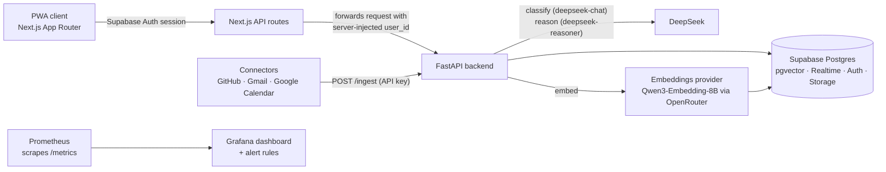

# ARIA — Personal AI Assistant

**Adaptive Reasoning & Intelligence Assistant**

ARIA is a personal, single-user PWA that captures tasks, events, reminders, and notes in natural language, routes every message through a typed intent classifier, and reasons over your own records with retrieval-augmented generation (RAG). It ships with a daily briefing, offline capture, external connectors (GitHub, Gmail, Google Calendar), and a full Prometheus/Grafana observability stack.

## What is implemented today

- **Natural-language capture** — write "remind me to…" or "schedule…"; the classifier decides record type, title, dates, and project, and the backend writes the record and confirms it.
- **7-intent routing with typed classifier output** — `capture`, `correction`, `query`, `context_note_update`, `conversation`, `web_search`, and `study`, resolved via a Pydantic v2 discriminated union on the `intent` field (see `backend/app/schemas/classifier.py`, `docs/adr/ADR-02.md`).
- **RAG over pgvector** — tasks, notes, events, reminders, and conversations are embedded (Qwen3-Embedding-8B, 4096 dims) into a Supabase Postgres `vector(4096)` column; retrieval uses a single SQL function that unions all sources with cosine similarity.
- **Daily briefing with cache and debounce** — a 3-state cache (fresh / stale / regenerate) with a 30-minute debounce window so captures don't trigger regeneration storms; deterministic task scoring.
- **Connectors** — GitHub, Gmail, and Google Calendar sync into `POST /ingest`, authenticated with an API key and deduplicated with partial unique indexes.
- **Offline capture** — an IndexedDB message queue drains pending chat messages on reconnect.
- **Observability** — Prometheus metrics endpoint (`/metrics`), a provisioned Grafana dashboard, and alert rules.
- **Study tools** — study plans, quizzes, explanations, flashcards, and summaries from pasted PDF/HTML/arXiv material, with follow-up context.
- **Documents** — PDF/TXT/MD upload to Supabase Storage, ingested as RAG-searchable notes with a `pending → processing → done | error` state machine.
- **Projects** — per-project chat scoped to a single project.

## Architecture



- The chat route classifies and embeds in parallel (`asyncio.gather`), then routes to the handler for the classified intent.
- There is no queue or worker: all work happens inline in the request.
- LLM and embedding providers sit behind abstract interfaces, so providers are swappable (`backend/app/providers/`).
- Design decisions are recorded in `docs/adr/` (ADR-01 through ADR-06).

## Getting started

### Prerequisites

- [Supabase CLI](https://supabase.com/docs/guides/cli) ≥ 1.200
- Docker + Docker Compose v2
- [uv](https://docs.astral.sh/uv/) (Python 3.12)
- [pnpm](https://pnpm.io/) ≥ 9
- psql 15+ (for the user seed script)

### 1. Clone and configure

```bash
git clone https://github.com/<your-user>/ARIA.git
cd ARIA
cp .env.example .env
```

### 2. Start Supabase and apply migrations

```bash
supabase start            # copy anon + service_role keys from `supabase status`
supabase db reset         # applies all migrations
```

Migrations create the schema but no user. Seed your initial user from
environment variables (the seed refuses unset or weak credentials):

```bash
export SEED_USER_EMAIL="you@example.com"
export SEED_USER_PASSWORD="<a strong password>"
psql "$SUPABASE_DB_URL" -X -f supabase/seed_initial_user.sql
```

See `docs/migrations.md` for migration notes.

### 3. Start the backend

```bash
docker compose up fastapi --build
# http://localhost:8000/health
```

### 4. Start the frontend

```bash
cd frontend
pnpm install
pnpm dev
# http://localhost:3000 — sign in with the user created by
# supabase/seed_initial_user.sql (SEED_USER_EMAIL / SEED_USER_PASSWORD)
```

### 5. Observability stack (optional)

```bash
docker compose up prometheus grafana -d
# http://localhost:3001 · http://localhost:9090
```

## Environment variables

Copy `.env.example` to `.env` and fill in real values. Key variables:

> Frontend variables (`NEXT_PUBLIC_*`) belong in `frontend/.env.local`, not in
> the root `.env`: `next dev` runs from `frontend/` and does not read the root
> file (see `frontend/next.config.mjs`). Create `frontend/.env.local` with the
> `NEXT_PUBLIC_*` entries below.

| Variable | Placeholder | Description |
|---|---|---|
| `SUPABASE_URL` | `http://localhost:54321` | Supabase project URL (backend) |
| `SUPABASE_ANON_KEY` | *(from `supabase status`)* | Backend anon key |
| `SUPABASE_SERVICE_ROLE_KEY` | *(from `supabase status`)* | Service-role key — server only, never exposed |
| `DEEPSEEK_API_KEY` | *(your key)* | `deepseek-chat` classification + `deepseek-reasoner` |
| `DEEPINFRA_API_KEY` | *(your key)* | Qwen3 embeddings via OpenRouter |
| `TAVILY_API_KEY` | *(optional)* | Web search primary provider (DuckDuckGo fallback) |
| `INGEST_API_KEY` | *(your value)* | API key for `POST /ingest` and connector sync |
| `GITHUB_TOKEN` | *(your token)* | GitHub connector |
| `GOOGLE_CLIENT_ID` / `GOOGLE_CLIENT_SECRET` | *(your values)* | Google OAuth for Gmail + Calendar |
| `GMAIL_REFRESH_TOKEN` / `CALENDAR_REFRESH_TOKEN` | *(your values)* | Connector OAuth refresh tokens |
| `CORS_ALLOWED_ORIGINS` | `http://localhost:3000` | Comma-separated backend CORS allowlist |
| `ALLOWED_DEV_ORIGINS` | *(empty = localhost only)* | Hosts allowed to reach the Next.js dev server |
| `RAG_MATCH_THRESHOLD` / `RAG_MATCH_COUNT` | `0.5` / `10` | RAG retrieval tuning |
| `BRIEFING_DEBOUNCE_MINUTES` | `30` | Stale window before briefing regeneration |
| `SEED_USER_EMAIL` / `SEED_USER_PASSWORD` | *(your values)* | Only for `supabase/seed_initial_user.sql` |
| `NEXT_PUBLIC_SUPABASE_URL` | `http://localhost:54321` | Frontend Supabase URL |
| `NEXT_PUBLIC_SUPABASE_ANON_KEY` | *(from `supabase status`)* | Frontend anon key |
| `NEXT_PUBLIC_API_URL` | `http://localhost:8000` | Frontend → FastAPI base URL |

## Local development

```bash
# Backend (hot reload)
cd backend && uv sync && uv run uvicorn app.main:app --reload

# Frontend
cd frontend && pnpm dev
```

## Testing

```bash
# Backend test suite
cd backend && uv sync && uv run pytest tests/ -v

# Frontend tests
cd frontend && pnpm test
```

## Project structure

```
ARIA/
├── backend/
│   ├── app/
│   │   ├── connectors/       GitHub, Gmail, Calendar sync
│   │   ├── core/             Config, deps, metrics, Supabase clients
│   │   ├── middleware/       Security headers, rate limit, request size, metrics
│   │   ├── providers/        LLM + embedding abstractions (DeepSeek, Qwen3)
│   │   ├── routes/           chat, briefing, ingest, reminders, events, connectors, documents
│   │   ├── schemas/          Classifier (discriminated union), chat, ingest models
│   │   └── services/         classifier, RAG, briefing, study, pdf, web search, …
│   └── tests/                backend test suite
├── frontend/
│   ├── app/                  App Router pages and API route handlers
│   ├── components/           chat, sidebar, …
│   └── lib/                  hooks (offline queue, realtime, reminder poll), Supabase clients
├── supabase/
│   ├── migrations/           Schema, pgvector, documents, RLS
│   └── seed_initial_user.sql Env-driven initial-user seed (manual)
├── docker/                   Prometheus config, alert rules, Grafana dashboard
├── docs/
│   ├── adr/                  ADR-01 … ADR-06, derived from code documentation
│   ├── deployment.md         Backend deployment pipeline (template)
│   └── migrations.md         Migration notes and seed instructions
└── ARIA_PRD_v1.md            Product requirements document
```

## Observability

- **Metrics** — Prometheus metric families for HTTP traffic, chat, classification, embedding, and RAG latency, records created, briefing cache hits/latency, context-note updates, connector events/errors, and offline queue depth (`backend/app/core/metrics.py`).
- **Scraping** — Prometheus scrapes `fastapi:8000/metrics` every 15 s; alert rules cover error rate and chat/RAG p95 latency (`docker/prometheus/alerts.yml`).
- **Dashboard** — Grafana auto-provisions the Prometheus datasource and a dashboard of panels covering the metric families above (`docker/grafana/`).
- `/metrics` is unauthenticated by design (it exposes no user data); protect it at the proxy if you expose the stack publicly.

## Security notes

- **Single-user by design** — no registration; one person manages everything. Don't expose ARIA to untrusted users.
- **Server-side identity injection** — the Next.js API routes inject `user_id` from the Supabase session; the browser never sends it (ADR-05).
- **API key for machine callers** — `POST /ingest` and `/connectors/sync/*` require the `X-API-Key` header.
- **Rate limiting** — in-memory per-IP limit of 100 requests / 60 s; 10 MB request body cap; document uploads restricted to PDF/TXT/MD.
- **Response headers** — `nosniff`, `frame-ancestors DENY`, XSS and referrer policies, restricted permissions.
- **CORS** — allowlist from `CORS_ALLOWED_ORIGINS`; localhost-only by default.

## Deployment

The backend ships as a Docker image via a GitHub Actions pipeline (test → build/push → SSH deploy with health check and rollback). The repository ships this pipeline as a template; see `docs/deployment.md` for the required configuration. A `frontend/vercel.json` exists for Vercel, but no frontend deploy pipeline is included in this repository.

## Roadmap

- Study material from YouTube and Google Drive (today only PDF, arXiv, and HTML are extracted).
- A verified production service worker — `@ducanh2912/next-pwa` is configured, but the checked-in `frontend/public/sw.js` is a dev stub and the production service worker has not been verified.

## License

No license has been chosen yet. All rights reserved by the repository owner until a license is added.
